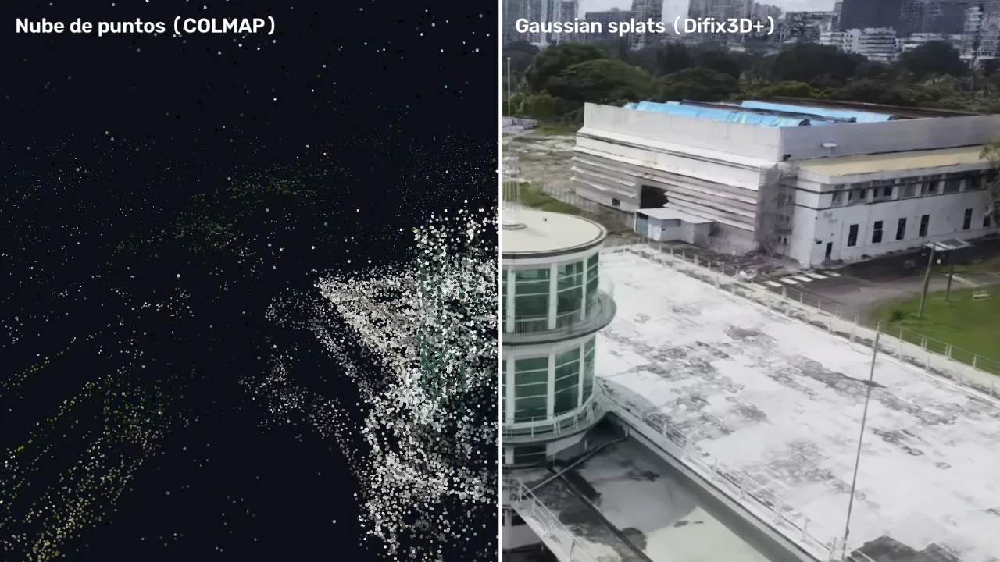
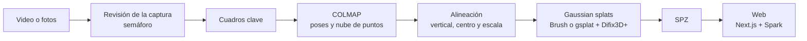
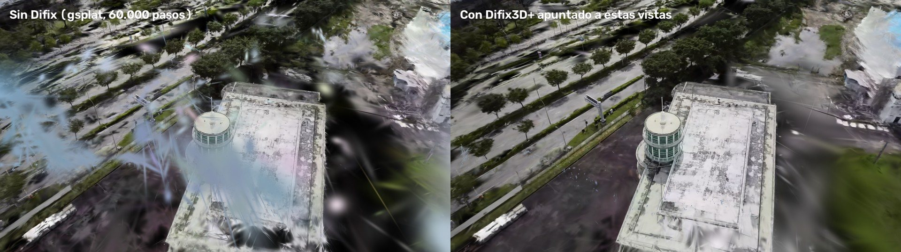

# DronAI

> Del video de un dron a una escena 3D que se recorre en el navegador.



DronAI toma fotos o un video de dron, calcula desde dónde se tomó cada imagen, entrena Gaussian splats y publica la
escena en una web estática. El pipeline corre en una laptop con una RTX 3050 de 4 GB; lo que no cabe ahí se entrena en
las dos GPU T4 gratuitas de Kaggle. No hay servidores de pago.

## Cómo funciona



1. **Revisión de la captura.** Antes de gastar GPU, un semáforo (verde, amarillo o rojo) mide nitidez, luz, textura y
   cortes, y sobre todo si la cámara se desplaza o solo gira: sin paralaje no hay 3D. Da los motivos y cómo grabar
   mejor.
2. **Cuadros clave.** De la toma continua más larga se queda con cuadros nítidos, separados lo justo para que haya
   paralaje.
3. **Poses.** COLMAP 4.2 con CUDA ubica cada cuadro y triangula la nube de puntos. Un video no trae GPS, así que DronAI
   alinea el modelo: encuentra la vertical con los ejes de las cámaras, lo centra donde miran y lo lleva a una escala
   de trabajo.
4. **Splats.** Brush en la laptop, o gsplat con [Difix3D+](https://research.nvidia.com/labs/toronto-ai/difix3d) de
   NVIDIA en Kaggle.
5. **Web.** Los splats se publican en SPZ con armónicos esféricos de grado 3 (el color cambia con el ángulo de vista) y
   se dibujan con [Spark](https://sparkjs.dev).

La web tiene una portada con un carrusel que compara la nube de puntos con los splats, un explorador por escena y
`/reconstruir`, que reproduce la reconstrucción paso a paso con datos reales: las fotos en el espacio, la nube que se
arma foto a foto y los splats que se afinan durante el entrenamiento. Ahí también se ve cómo la revisión juzgó ocho
videos de prueba. La cámara de la portada y del explorador va por el recorrido del dron (o, en las escenas de fotos,
por una órbita a su altura), porque fuera de lo que el dron vio la reconstrucción se deshace en manchas.

## Escenas

| Escena | Captura | Poses | Splats | Entrenamiento |
| --- | --- | --- | --- | --- |
| Torre del aeropuerto de Kallang, Singapur | Video de 54 s, 114 cuadros clave | COLMAP (DronAI) | 1.630.718 | gsplat + Difix3D+, 60.000 pasos, Kaggle |
| Abadía de Jumièges, Francia | Video de 85 s, 73 cuadros clave | COLMAP (DronAI) | 132.974 | Brush, 7.000 pasos, laptop |
| Obra con tuberías, Canadá | 97 fotos | Del dataset | 998.663 | Brush, 7.000 pasos, laptop |
| Casa con piscina, EE. UU. | 220 fotos | Del dataset | 328.612 | Brush, 7.000 pasos, laptop |
| Casa de techo marrón, EE. UU. | 180 fotos | Del dataset | 762.516 | Brush, 7.000 pasos, laptop |

## Resultados medidos en Kallang

Sobre 15 cuadros del video que se apartaron al entrenar (1 de cada 8):

| Modelo | Pasos | PSNR | SSIM | Tiempo | Splats |
| --- | --- | --- | --- | --- | --- |
| Brush | 7.000 | 27,53 dB | 0,890 | 9 min en la RTX 3050 | 354 mil |
| Brush | 30.000 | 28,84 dB | 0,916 | 49 min en la RTX 3050 | 816 mil |
| gsplat | 60.000 | 27,89 dB | 0,904 | 2 h 20 min en una T4 | 1,89 millones |
| gsplat + Difix3D+ | 60.000 | 27,89 dB | 0,902 | 2 h 20 min en una T4 | 1,85 millones |

Brush se midió con un script propio y gsplat con su evaluación: la misma fórmula, con código distinto. Los cuadros
apartados están sobre el recorrido del dron, así que miden la calidad vista desde ahí; lo que cambia Difix3D+ se ve
desde otros ángulos, que no tienen foto real con qué comparar.

### Difix3D+ apuntado a lo que muestra la web



Difix3D+ dibuja vistas nuevas durante el entrenamiento, les quita las manchas con un modelo de difusión de un paso y
las suma como si fueran fotos. La receta de NVIDIA acerca esas vistas a los cuadros apartados, que en un vuelo en
órbita quedan sobre el mismo recorrido del dron, donde el modelo ya se ve bien. DronAI las lleva hacia dos anillos de
vistas más altas y lejanas, como las del visor (20° a distancia 35 y 40° a distancia 45), avanzando 2 unidades por
pasada desde las cámaras del dron: llegan en las pasadas 7 y 14 de 16. En el recorrido el PSNR queda igual; desde
arriba desaparecen casi todos los velos y rayones.

Para que quepa en una T4, Difix corre en fp16 y a 1024×576 (en fp32 y a 1598×898 pide más de 15 GB). El notebook
[worker/kaggle/difix3d.ipynb](worker/kaggle/difix3d.ipynb) instala todo, ajusta el código de NVIDIA para Kaggle y
verifica imports, datos, la compilación de gsplat y la memoria de Difix antes de gastar horas de GPU.

## Correr en local

```bash
cd web
npm install
npm run dev
```

Abre <http://localhost:3000>. Las escenas vienen en el repositorio (`web/public/scenes`, unos 350 MB), así que todo
funciona sin generar nada. Con dos GPU en una laptop, asigna la NVIDIA al navegador en la configuración de gráficos de
Windows.

Para reconstruir escenas propias: [worker/README.md](worker/README.md) explica la revisión de la captura, los cuadros
clave, COLMAP, el entrenamiento con Brush y la conversión a SPZ (`web/scripts/splats-to-spz.mjs`). El entrenamiento
con Difix3D+ va en Kaggle, con una escena empaquetada con `dronai-worker kaggle-pack`.

## Stack

- **Web:** Next.js 16, React 19, Tailwind 4, React Three Fiber 9, three.js 0.187 y Spark 2.4.
- **Pipeline:** Python 3.12 con NumPy y OpenCV, COLMAP 4.2 con CUDA y Brush 0.3.
- **Kaggle:** PyTorch, gsplat 1.5 y Difix3D+.

Las decisiones y sus motivos están en [docs/arquitectura.md](docs/arquitectura.md).

## Estructura

```text
DronAI/
├── web/      Portada, explorador y reconstrucción paso a paso (Next.js)
├── worker/   Pipeline en Python y notebook de Kaggle
└── docs/     Arquitectura, decisiones e investigación
```

## Licencias y créditos

- **Código:** licencia [MIT](LICENSE).
- **Escenas** (`web/public/scenes`): son reconstrucciones de material de terceros y conservan su licencia.
  - Torre de Kallang: video de [Daniel Taka](https://commons.wikimedia.org/wiki/File:Kallang_Airport,_360_degree_view.webm)
    en Wikimedia Commons, CC BY 4.0.
  - Abadía de Jumièges: video de
    [Raimond Spekking](https://commons.wikimedia.org/wiki/File:Abbaye_de_Jumi%C3%A8ges_from_quadcopter.webm) en
    Wikimedia Commons, CC BY-SA 4.0.
  - Obra con tuberías y las dos casas: [DroneDeploy NeRF Dataset](https://github.com/nickponline/dd-nerf-dataset),
    CC BY-NC-SA 4.0 (uso no comercial).
- **Difix3D+:** el notebook baja el modelo de NVIDIA desde Hugging Face; sus pesos no están en este repositorio y
  tienen su propia licencia.
