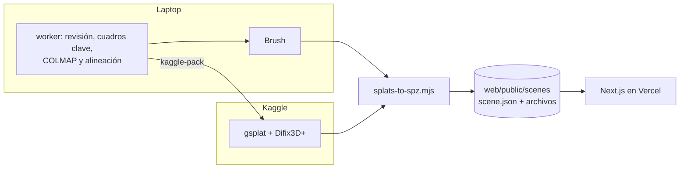

# Arquitectura y decisiones

DronAI es un pipeline que corre fuera de línea y una web estática. Las escenas se reconstruyen en una laptop o en
Kaggle y se publican como archivos; la web no tiene servidor propio ni base de datos.

El plan original (noviembre de 2026) era una app pública: cualquiera subiría su video y lo pesado correría en una GPU
de pago en la nube (Modal), con login, cuotas, una capa de IA y un dron virtual entrenado con aprendizaje por
refuerzo. El 19 de noviembre se dejó de lado para no pagar GPU: el objetivo pasó a ser un proyecto pulido, con escenas
que se vean bien y un repositorio que cualquiera pueda descargar y correr. La investigación de esa etapa sigue en
[investigacion/](investigacion/README.md) como contexto.

## Restricciones

- **Laptop:** RTX 3050 de 4 GB, i5-11400H, 15,7 GB de RAM y Windows 11.
- **Sin GPU de pago:** lo que no cabe en 4 GB se entrena en Kaggle (dos T4 de 16 GB, unas 30 horas por semana gratis).
- **Hosting gratuito:** Vercel en el plan Hobby, desplegado desde GitHub.

## Componentes

- **`worker/`** (Python): revisa la captura, elige cuadros clave, corre COLMAP, alinea el modelo y escribe lo que
  necesitan el entrenamiento y la web. Comandos en [worker/README.md](../worker/README.md).
- **Brush** entrena en la laptop; el notebook [worker/kaggle/difix3d.ipynb](../worker/kaggle/difix3d.ipynb) entrena
  en Kaggle.
- **`web/scripts/splats-to-spz.mjs`** convierte los PLY a SPZ y actualiza el `scene.json` de la escena.
- **`web/`** (Next.js) lee `public/scenes/<escena>/scene.json`: cámaras, nube, splats, capturas del entrenamiento y
  datos de la captura. Todo lo que la web muestra sale de esos archivos.

## Decisiones

| Tema | Decisión | Motivo |
| --- | --- | --- |
| Poses | COLMAP 4.2 con CUDA: emparejamiento exhaustivo y mapper incremental para videos cortos | Cierra las órbitas y ubicó todos los cuadros de Kallang (114) y de la abadía (73). Binario oficial para Windows y licencia BSD. |
| Alineación | Vertical estimada con los ejes "derecha" de las cámaras, centro en el punto al que miran y radio de trabajo 20 | Un video no trae GPS ni metros. Así todas las escenas quedan derechas y a una escala parecida. |
| Splats en la laptop | Brush 0.3 (WebGPU, Apache-2.0) | Entrena en Windows sin compilar CUDA: 30.000 pasos de Kallang en 49 minutos con 4 GB. |
| Splats en Kaggle | gsplat 1.5 con Difix3D+ | Difix3D+ limpia las vistas que el dron no vio. Necesita más memoria que la laptop. |
| Formato | SPZ con armónicos esféricos de grado 3 | Entre 25 y 37 % más liviano que `.splat`, y conserva el color que cambia con el ángulo de vista. |
| Visor | React Three Fiber 9 con Spark 2.4 sobre WebGL2 | Lee todos los formatos de splats y se integra con three.js. |
| Cámara | La portada y el explorador comparten el recorrido de `landing/camera-path.ts` | Fuera de lo que el dron vio, la reconstrucción se deshace en rayas. En las escenas de video la cámara repite el vuelo; en las de fotos, una órbita a su altura. |
| Hosting | Vercel desplegado desde GitHub, con las escenas en el repositorio | La CLI de Vercel acepta hasta 100 MB por despliegue en el plan Hobby; los despliegues desde Git no tienen ese límite. Además, quien clona el repositorio tiene la demo completa. |

## Revisión de la captura y semáforo

Un video malo no se arregla con IA: si está oscuro o borroso, o la cámara no se desplaza, lo que se agregue es
inventado y se ve mal. Por eso, antes de reconstruir, `dronai-worker review` revisa la captura y da un veredicto con los
motivos.

**Qué mide.** En CPU, sobre cuadros reducidos a 960 px (8 por segundo en un video):

- Nitidez (con la métrica de re-desenfoque de Crété, que no confunde una superficie lisa con una foto movida), luz y
  detalle (qué parte de la imagen tiene esquinas que se pueden seguir: el cielo, el agua y las paredes lisas no
  tienen).
- Movimiento: sigue puntos de un cuadro al siguiente (KLT) o empareja fotos (SIFT) y mide el **paralaje**, la parte
  del movimiento de la imagen que ningún giro puro de la cámara explica. Si la cámara solo gira, ese residuo es casi
  cero; si se desplaza, lo cercano y lo lejano se mueven distinto, que es lo que COLMAP necesita para triangular.
- Cortes de edición y tramos en que la cámara va tan rápido que se pierde el hilo.

| Veredicto | Cuándo |
| --- | --- |
| Verde | Sin problemas |
| Amarillo | Problemas en parte de la captura: tramos borrosos u oscuros, cortes, superficies lisas o tramos en que solo gira |
| Rojo | Demasiado oscura, borrosa o corta, o la cámara no se desplaza |

Umbrales, calibración y los ocho videos de prueba: [worker/README.md](../worker/README.md#revisión-de-la-captura).

## Difix3D+ en Kaggle

[Difix3D+](https://research.nvidia.com/labs/toronto-ai/difix3d) (NVIDIA, CVPR 2025) sigue a un modelo ya entrenado:
cada 2.000 pasos dibuja vistas nuevas, les quita las manchas con un modelo de difusión de un paso (basado en SD-Turbo)
usando como referencia la foto real más cercana, y las suma al entrenamiento. El notebook entrena dos corridas en
paralelo, una por T4: 60.000 pasos de gsplat sin Difix y los mismos 60.000 con 16 pasadas de Difix en la segunda mitad.

Lo que hubo que ajustar al código de NVIDIA para que corra en Kaggle y sirva para la web:

- **numpy 2:** el lector de COLMAP que usa gsplat escribe "sin punto 3D" como `np.uint64(-1)`, que numpy 2 rechaza.
- **Reparto de cuadros:** con `test_every=8`, su `Dataset` entrena con 1 de cada 8 cuadros (su benchmark es de vistas
  escasas). Se invierte para entrenar con 7 de cada 8, como en Brush.
- **Memoria:** cada pasada dejaba vivos los procesos del cargador anterior; queda solo el último. Difix corre en fp16 y
  a 1024×576, porque en fp32 y a resolución completa no cabe en 15 GB.
- **Hacia dónde mira:** la receta original lleva las vistas nuevas hacia los cuadros apartados, que en una órbita están
  sobre el recorrido del dron. Aquí avanzan hacia dos anillos de vistas altas y lejanas, como las del visor, que es
  donde se veían las fallas.

Difix solo aprende donde el render ya tiene contenido, así que limpia y rehace lo que existe pero no agrega objetos.
Lo que inventa no se puede medir contra una foto: se compara a ojo, y el notebook guarda los dos modelos dibujados desde
las mismas vistas lejanas.

## Lo que no se hizo, y por qué

- **Subida de videos y GPU en la nube:** costaba dinero por cada visitante. La revisión de la captura y el pipeline
  quedan para correrlos en local.
- **Boceto con Depth Anything 3:** COLMAP más splats resolvió las cinco escenas; el boceto no hizo falta.
- **Comprimir con splat-transform a SOG:** Spark lee SPZ y el conversor propio alcanzó.

## Licencias

- **Herramientas:** COLMAP (BSD), Brush y gsplat (Apache-2.0), Spark (MIT). Difix3D+ tiene la licencia de NVIDIA más
  las condiciones de SD-Turbo; el notebook baja el modelo y no se redistribuye.
- **Escenas:** cada una conserva la licencia de su material de origen (ver el [README](../README.md#licencias-y-créditos)).
- **Código de DronAI:** MIT.
